<p align="center">
  
</p>

<h1 align="center">Imava Gallery</h1>

<p align="center">
  <b>The private, offline-first, zero-cloud gallery for Android.</b><br>
  Engineered with Jetpack Compose, Material 3, Room, Coil, and hardware-backed cryptography.
</p>

<p align="center">
  <a href="#license"></a>
  
  
  
</p>

---

<!-- SCREENSHOTS_START -->
## Screenshots

<div align="center">
  <table>
    <tr>
      <td align="center" width="25%">
        <b>Photos Timeline</b><br><br>
        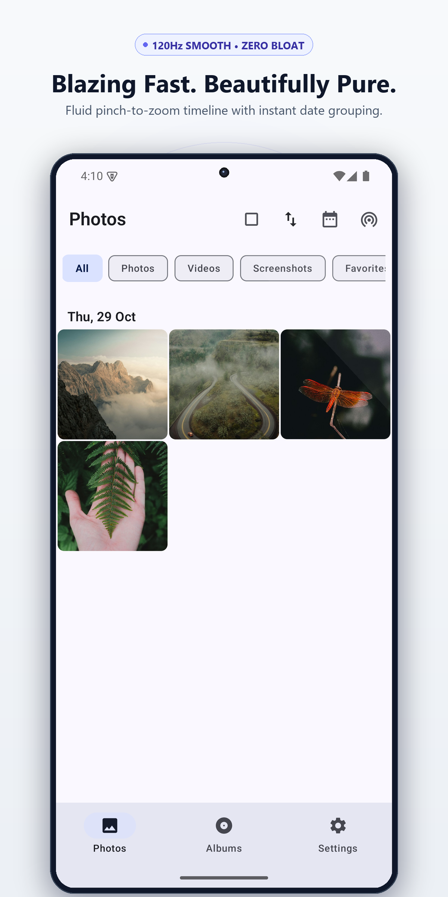
      </td>
      <td align="center" width="25%">
        <b>Albums & Memories</b><br><br>
        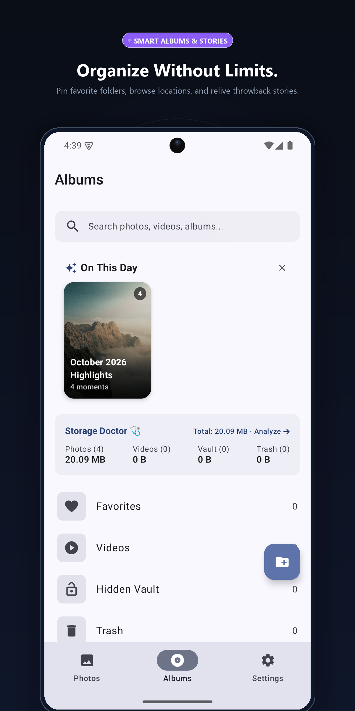
      </td>
      <td align="center" width="25%">
        <b>Batch Selection & Tools</b><br><br>
        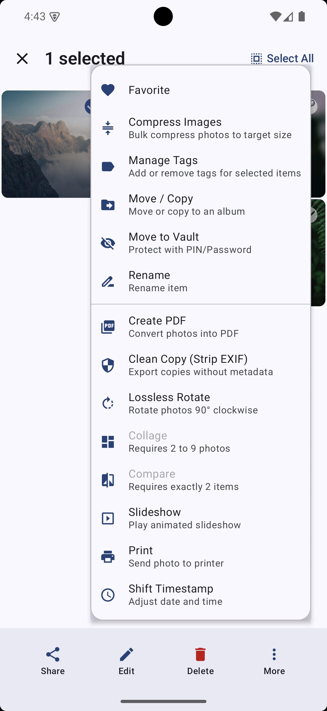
      </td>
      <td align="center" width="25%">
        <b>Filter & Tag Manager</b><br><br>
        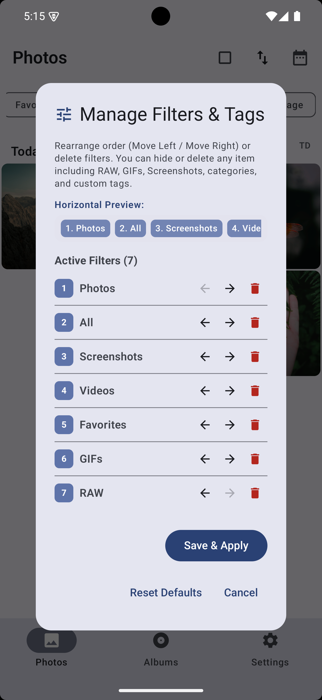
      </td>
    </tr>
    <tr>
      <td align="center" width="25%">
        <b>Hardware Encrypted Vault</b><br><br>
        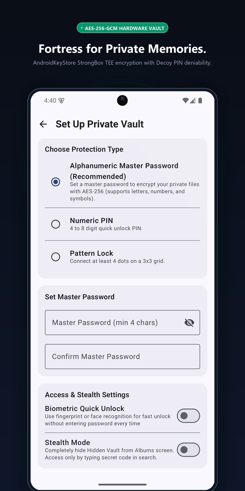
      </td>
      <td align="center" width="25%">
        <b>App Switcher Shield</b><br><br>
        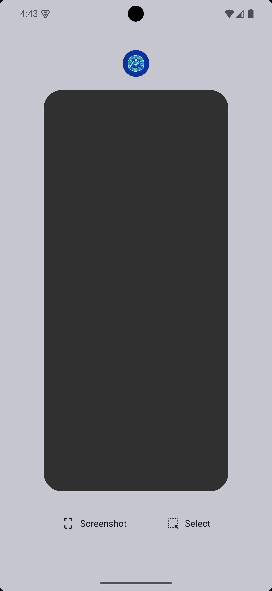
      </td>
      <td align="center" width="25%">
        <b>About & FOSS Transparency</b><br><br>
        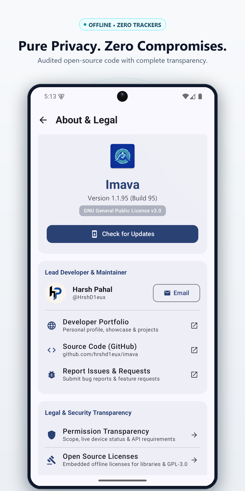
      </td>
      <td align="center" width="25%">
        <b>Album Privacy & Security</b><br><br>
        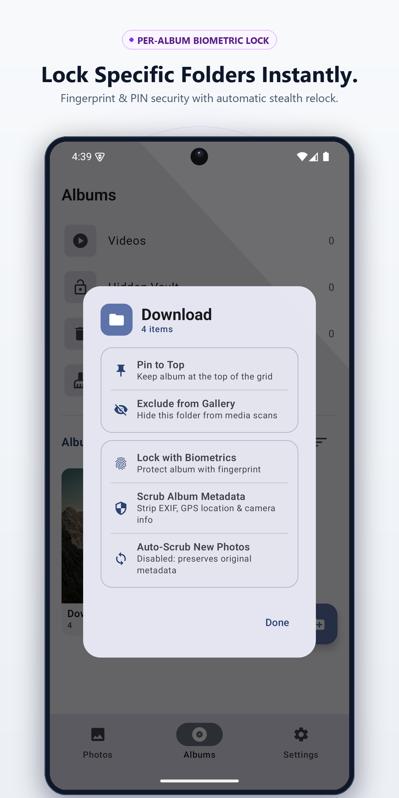
      </td>
    </tr>
    <tr>
      <td align="center" width="25%">
        <b>Language Localization</b><br><br>
        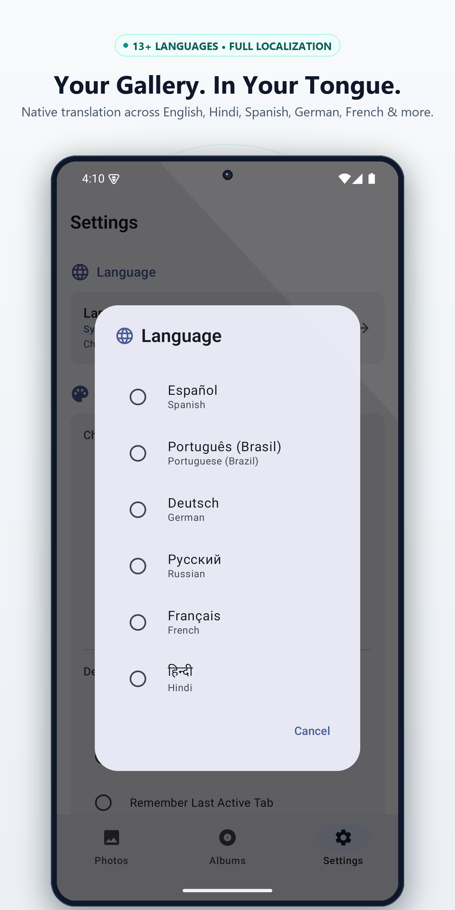
      </td>
      <td align="center" width="25%">
        <b>Imava Drop (Wi-Fi P2P)</b><br><br>
        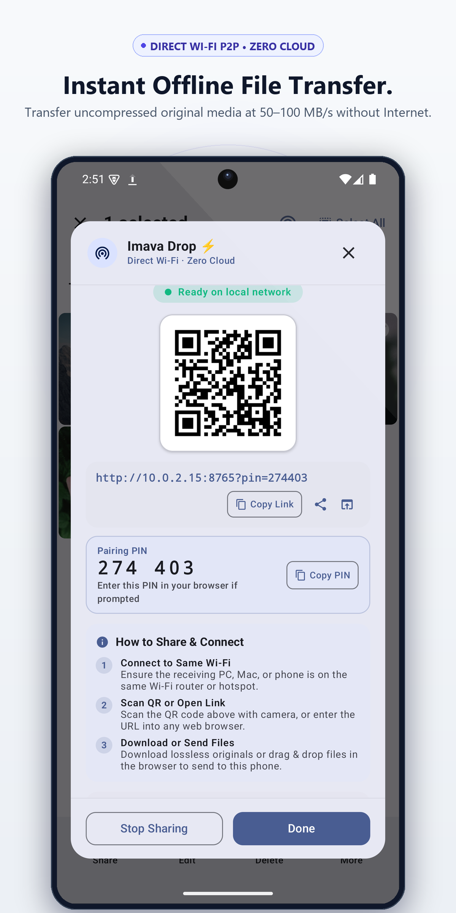
      </td>
      <td align="center" width="25%">
        <b>Imava Drop Web Portal</b><br><br>
        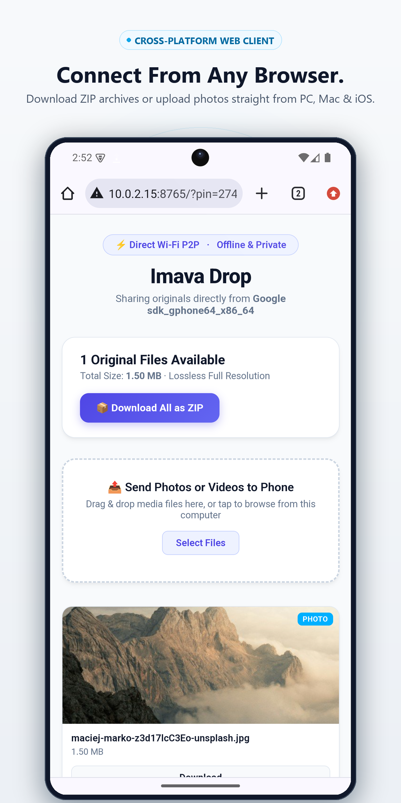
      </td>
      <td align="center" width="25%">
        <b>Tablets & Foldables UI</b><br><br>
        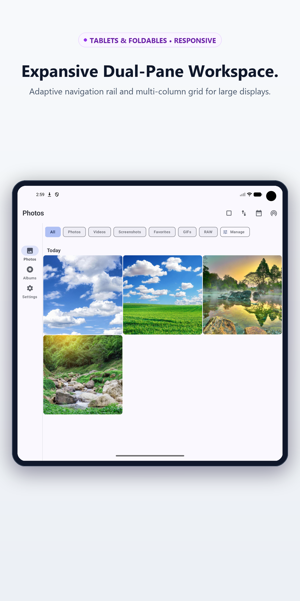
      </td>
    </tr>
  </table>
</div>
<!-- SCREENSHOTS_END -->

---

## Killer & Unique Features

Imava is built specifically for users who refuse cloud telemetry, mandatory accounts, and corporate tracking. Below are the advanced features that set Imava apart from standard Android galleries:

### 1. Direct Wi-Fi P2P Drop (Imava Drop - Zero Cloud)
- **Instant 50–100+ MB/s Transfers**: Stream full, lossless original photos and 4K videos directly between your Android phone and any PC, Mac, iPhone, Linux, or secondary Android device over local Wi-Fi.
- **Zero Client Software Needed**: Receivers don't install an app or create an account. They simply scan an on-device QR code or open `http://192.168.x.x:8765` in any standard web browser (Chrome, Safari, Firefox, Edge).
- **On-the-Fly Dynamic ZIP Generator**: Download hundreds of selected photos as a single uncompressed ZIP stream with zero intermediate disk space used on your phone.
- **Bidirectional Drag-and-Drop Web Upload**: Desktop computers can drag-and-drop photos and videos directly onto the browser page to transfer them straight into your phone's gallery (`Pictures/ImavaDrop`).
- **System Share Sheet Integration**: Send photos or videos directly to **Imava Drop** from WhatsApp, Telegram, Chrome, or any Android app's Share menu without unlocking or opening the full gallery.

### 2. Cryptographic DoD File Shredder & Biometric Trash Lock
- **Anti-Recovery Physical Sector Overwrite**: Standard OS file deletion (`unlink`) only removes catalog pointers, leaving raw JPEG/MP4 blocks readable by data recovery tools (DiskDigger, Recuva, PhotoRec). Imava's shredder overwrites clusters with cryptographically secure random bytes in 64KB buffers (`"rws"` mode), zeroes magic headers, forces hardware write cache flush via `FileDescriptor.sync()`, scrambles directory entries, and truncates to 0 bytes before unlinking.
- **Biometric Trash Lock**: Specifically guard your Trash folder behind fingerprint, face unlock, or device PIN. Deleted item counts are completely masked until unlocked, preventing nosy friends or family from snooping through deleted photos. Auto-relocks on backgrounding.

### 3. Hardware-Backed AES-256-GCM Vault & Dynamic Decoy Credentials
- **AndroidKeyStore Hardware Isolation**: Media files inside the Hidden Vault are encrypted using AES-256-GCM with hardware-backed keys and PBKDF2WithHmacSHA256 (100,000 iterations for master credentials, 250,000 iterations for `.imava` encrypted backup archives). Decrypted blocks live strictly in transient memory and are zeroed upon locking.
- **Dynamic Plausible Deniability Decoy (Pattern, PIN, Password)**: Coercion-resistant secondary credential that dynamically mirrors your master lock type. If your master lock is a 3x3 Pattern, your decoy is a Decoy Pattern drawn on the identical pattern view. If locked with a numeric PIN or alphanumeric password, the decoy seamlessly prompts for PIN or password. Entering the decoy credential unlocks a harmless, empty decoy vault while keeping your real private media mathematically hidden.
- **Independent Cryptographic Salting & Collision Guard**: Decoy credentials use an isolated, dedicated salt (`vault_decoy_salt`). Master credential changes or re-salting never invalidate your decoy setup. Built-in collision protection prevents setting matching master/decoy combinations and automatically guards against lock-type migration inconsistencies.
- **Direct In-Vault Import (FAB)**: Import photos and videos directly into the encrypted vault from internal gallery storage or external file pickers using a dedicated floating `+` button.
- **Stealth Mode Access**: Hide the Hidden Vault tile entirely from the Albums screen. It can only be opened by typing your secret access code directly into the gallery search bar.

### 4. Local EXIF Sanitizer & Automatic Background Scrubbing
- **On-the-Fly Metadata Stripping**: Strip embedded GPS coordinates, camera serial numbers, and device fingerprints before sharing photos to messaging apps or social networks.
- **Album-Wide In-Place Scrubbing**: Sanitize entire albums with a single tap while intelligently preserving `DateTimeOriginal` and orientation tags so gallery chronology and photo rotation remain intact.
- **Background Auto-Scrub Daemon**: Automatically sanitize newly captured photos in designated folders (e.g. Camera, Downloads) with a camera write-lock debounce.

### 5. Private WebDAV / Home NAS Zero-Cloud Auto-Sync (Atomic Staging)
- **100% Self-Hosted & Local**: Automatically back up your library to home NAS appliances (Synology, Nextcloud, TrueNAS, QNAP, ownCloud) or custom WebDAV endpoints over your local network.
- **Atomic Two-Phase Upload Engine**: Staged upload to `.imava_tmp` followed by atomic RFC 4918 `MOVE` destination rename. Network drops or power loss will never leave half-written, corrupted files on your NAS.
- **Redundant Upload Suppression**: Performs remote `HEAD` probes and `Content-Length` checks prior to transfer, skipping already backed-up files and saving mobile bandwidth and battery.
- **Zero Third-Party Cloud**: No external servers, no subscriptions, and zero telemetry. Media never touches commercial cloud providers.
- **Automated WorkManager Scheduling**: Incremental sync ledger backed by SQLite ensures only new/modified photos are uploaded, with strict **Wi-Fi Only** and **Device Charging** constraints.

### 6. Tablet & Foldable Responsive Dual-Pane Architecture
- **Adaptive Layout Engine**: Automatically transforms from single-column phone ergonomics to an edge-to-edge Navigation Rail and dual-pane layout on wide screens (tablets, unfolded foldables, and landscape devices).
- **Master-Detail Album Tree**: Browse the album list and hierarchical directory tree on the left while simultaneously viewing the live media grid on the right—eliminating jarring screen transitions.
- **Smooth State Persistence**: Seamlessly preserves scroll positions, active selections, and grid scaling when unfolding foldables or rotating tablets.

### 7. Zero-ML Blurry Photo Detector (Storage Doctor)
- **Pure Discrete Mathematics**: Analyzes images using a 3x3 discrete Laplacian edge operator ($\sigma^2$ variance) on sub-sampled luminance planes.
- **Zero Neural Network Bloat**: Operates at lightning speed with zero external ML/AI libraries, no 25MB+ weights bloat, and virtually zero battery drain compared to heavy vision models.
- **Actionable Cleanup**: Intelligently groups motion-blurred shots and accidental out-of-focus captures with customizable sensitivity thresholds for 1-tap review and batch deletion.

### 8. Smart Albums 2.0 (Deterministic Rule Engine)
- **Zero-AI High Precision**: Replaces slow, inaccurate AI photo tagging with deterministic, lightning-fast SQLite rule queries.
- **Instant Specialized Collections**: 1-tap access to **Huge Videos (>500MB)**, **Burst Sequences**, **Captured This Year**, **Screenshots**, and **Tagged Media**.
- **Real-Time Dynamic Chips**: Badged chips provide instant feedback on count and storage footprints without background indexing lag.

### 9. On-Device FOSS OCR & Text Search (Tesseract 5 C++)
- **Google-Free OCR Engine**: Powered by open-source Tesseract 5 C++ via Tesseract4Android (Apache 2.0). Zero dependencies on Google Play Services, Firebase, or proprietary ML blobs.
- **On-Demand Engine Loading**: The fast English recognition model (`eng.traineddata`) is loaded on-demand only when used—keeping the base APK ultra-lean.
- **Searchable Gallery Indexing**: Extracted text from receipts, documents, street signs, and serial numbers is indexed into your local SQLite Room database, making physical text searchable directly from the gallery search bar.
- **Actionable Smart Chips**: 1-tap detection and interaction for phone numbers (call/copy), URLs (browser/copy), and email addresses.

### 10. Instant Deep Media & Hidden Vault Carve (<100ms)
- **Direct SQLite Filesystem Carving**: Direct multi-pattern `MediaStore.Files` database query with `QUERY_ARG_MATCH_NOMEDIA` unearths hidden photos in under 100ms without filesystem crawl lag.
- **App & Cloned Space Registry**: Instantly discovers sent folders, dual/cloned app spaces, and hidden media lurking inside `.nomedia`, `.hidden`, `.secret`, `.vault`, `.calculator`, and `.thumbnails` directories.

### 11. Motion Photo Studio, Samsung Galaxy Support & HDR Video
- **Universal Motion Photo Engine**: Decodes both Google Camera `MicroVideo` and Samsung Galaxy `MotionPhoto_Data` embedded video streams with interactive precision frame scrubbers.
- **Hardware HDR Video Playback**: Automatically requests 10-bit wide-color gamut rendering (`ActivityInfo.COLOR_MODE_HDR`) on HDR-capable OLED and mini-LED displays, preventing tone-mapping clipping.
- **Best-Shot Extraction**: Extract full-sensor, uncompressed still images from motion photos at full resolution.
- **Pure-Kotlin GIF89a Export**: Export motion photos to looping GIFs using a built-in, zero-dependency Octree color quantizer.

### 12. Camera RAW Pipeline & High-Performance Preview Decoder
- **Zero-RAM EXIF Thumbnail Extraction**: Instantaneous preview decoding for professional camera RAW containers without loading multi-megabyte uncompressed sensor arrays into RAM.
- **Broad Format Coverage**: Full support for Sony (`.arw`, `.srf`, `.sr2`), Canon (`.cr2`, `.cr3`), Nikon (`.nef`, `.nrw`), Fujifilm (`.raf`), Olympus (`.orf`), Panasonic (`.rw2`), Pentax (`.pef`), Samsung (`.srw`), and Adobe DNG (`.dng`).

### 13. Interactive Geo Map & Spatial Descriptions
- **Zero-Binary Map Explorer**: Lightweight Leaflet + OpenStreetMap engine (<150 KB, 0 native `.so` binaries) with dynamic cluster markers for all geotagged photos.
- **Free-Form Spatial Search**: Add descriptive place tags (e.g., *"delhi rohtak madina village printing press"*) without needing numeric coordinates, with instant gallery search indexing.

### 14. Multi-Language Engine & Android 13+ Per-App Locale
- **Complete Native Translations**: 100% offline translations across **13 Android resource folders** covering **12 languages** (plus `System Default`): English, Spanish, Portuguese (`pt` & `pt-BR`), German, Russian, French, Hindi, Bengali, Marathi, Telugu, Tamil, and Gujarati.
- **Android 13+ Per-App Locale Architecture**: Fully integrated with Android's system-level `LocaleManager` (`android:localeConfig`) as well as an in-app selector with native script typography.

### 15. Privacy Shield & Biometric App Lock
- **Recent Apps Masking**: Applies `FLAG_SECURE` to prevent Android's recent task switcher from snapshotting personal photos or vault contents.
- **Biometric App Guard**: Secure entire gallery launch behind fingerprint, face unlock, or PIN with rate-limited lockout protection.

### 16. Zero-Flicker Synchronous Auto-Fit Typography Engine
- **Single-Pass Text Measurement**: Powered by Jetpack Compose's native `rememberTextMeasurer`, typography automatically measures layout constraints in memory without multi-frame recomposition loops or UI flicker.
- **Adaptive Font Scaling**: Dynamically scales typography down to defined minimum limits (e.g. 8sp–10sp) before applying ellipsis. This prevents awkward text truncation on compact phone screens (320dp/360dp) and ensures full readability across long German compound words, French phrases, and complex Indic script action labels.
- **System-Wide UI Ergonomics**: Integrated across the selection action bar, vault setup cards, security unlock screens, and modal dialog buttons.

---

## Tech Stack

Imava is crafted with a pure, audited open-source foundation:

| Layer | Technology | License |
|:---|:---|:---:|
| **Language** | Kotlin 1.9.22 | Apache 2.0 |
| **UI Toolkit** | Jetpack Compose (Material 3) + TextMeasurer Auto-Fit | Apache 2.0 |
| **Architecture** | ViewModel + StateFlow + Kotlin Coroutines | Apache 2.0 |
| **Dependency Injection** | Dagger Hilt 2.51.1 | Apache 2.0 |
| **Database** | SQLite via Room 2.6.1 (KSP) | Apache 2.0 |
| **Image Loading** | Coil 2.6.0 (Custom MediaStore Fetcher & Sub-sampling) | Apache 2.0 |
| **Media Player** | AndroidX Media3 ExoPlayer 1.3.1 | Apache 2.0 |
| **Background Work** | AndroidX WorkManager 2.9.0 | Apache 2.0 |
| **Authentication** | AndroidX Biometric 1.1.0 | Apache 2.0 |
| **Cryptography** | AndroidKeyStore AES-256-GCM + PBKDF2 | Hardware-Backed |
| **Networking & NAS** | OkHttp 4.12.0 + Okio | Apache 2.0 |
| **On-Device OCR** | Tesseract 5 & Leptonica (Tesseract4Android) | Apache 2.0 |
| **Map Rendering** | Leaflet + OpenStreetMap (<150 KB, 0 native binaries) | BSD-2-Clause |

---

## Audited Permissions & Privacy Transparency

Imava operates on a strict **zero-telemetry, offline-first** security model. Every permission declared in [`AndroidManifest.xml`](file:///h:/Programming/Main%20Projects/Android/Gallery/app/src/main/AndroidManifest.xml) is tracked in the in-app **Permissions Transparency Screen** (`Settings > Permissions Transparency`):

| Permission | Introduced / Scoped | Technical Purpose & Privacy Justification |
| :--- | :---: | :--- |
| `READ_MEDIA_IMAGES` / `READ_MEDIA_VIDEO` | API 33+ (Android 13) | Standard OS media access to display, query, and index photo and video libraries. |
| `READ_MEDIA_VISUAL_USER_SELECTED` | API 34+ (Android 14) | Supports Android 14 granular user selection when full library access is not granted. |
| `READ_EXTERNAL_STORAGE` / `WRITE_EXTERNAL_STORAGE` | API 1–32 (Legacy) | Scoped to Android 12 and below (`maxSdkVersion=32` / `29`) for legacy storage compatibility. |
| `MANAGE_EXTERNAL_STORAGE` | API 30+ (Android 11) | Direct filesystem traversal for Deep Media Scan (`.nomedia`, dual/cloned spaces, chat media), lossless in-place EXIF rotation, and physical sector file shredding. |
| `ACCESS_MEDIA_LOCATION` | API 29+ (Android 10) | Accesses embedded GPS coordinates in EXIF headers to populate the photo map and detail sheets. |
| `USE_BIOMETRIC` / `USE_FINGERPRINT` | API 23+ (Android 6) | Hardware-backed biometric prompts for Hidden Vault, locked albums, and Trash lock. |
| `INTERNET` / `ACCESS_NETWORK_STATE` / `ACCESS_WIFI_STATE` / `CHANGE_WIFI_MULTICAST_STATE` | API 1+ | Restricted strictly to local Wi-Fi P2P Drop (`http://192.168.x.x`), local WebDAV NAS sync, and in-app GitHub update checks. Media never leaves your local network. |
| `REQUEST_INSTALL_PACKAGES` | API 26+ (Android 8) | Enables 1-tap in-app APK installation for direct GitHub release updates (omitted for Play Store builds). |
| `FOREGROUND_SERVICE` / `FOREGROUND_SERVICE_DATA_SYNC` | API 28+ (Android 9) | Maintains active Wi-Fi Drop and WebDAV sync transfers when the screen is locked or app minimized. |
| `POST_NOTIFICATIONS` | API 33+ (Android 13) | Displays progress notifications during background WebDAV backups and active Wi-Fi Drop file transfers. |
| `VIBRATE` | API 1+ | Tactile haptic feedback on grid interactions, fast-scroller jumps, drag selections, and lock errors. |
| `SET_WALLPAPER` / `SET_WALLPAPER_HINTS` | API 1+ | Sets home and lock screen wallpapers directly from the photo viewer. |

> [!NOTE]
> **Zero Invasive Tracking**: Imava contains **no advertising IDs**, **no Google Analytics / Firebase**, **no Crashlytics**, **no contacts or microphone permissions**, and **no third-party cloud SDKs**.

---

## Supported Languages

Imava ships **100% offline UI & notification translations** across **12 languages** (`locales_config.xml` + `System Default`) backed by **13 `strings.xml` locale folders**, all verified for key and format-placeholder parity in unit tests:

| Language | Native Name | Locale Code | Resource Folder(s) |
| :--- | :--- | :--- | :--- |
| **English** *(Default)* | English | `en` | `values` |
| **Spanish** | Español | `es` | `values-es` |
| **Portuguese (Brazil / Fallback)** | Português (Brasil) | `pt-BR` | `values-pt-rBR`, `values-pt` |
| **German** | Deutsch | `de` | `values-de` |
| **Russian** | Русский | `ru` | `values-ru` |
| **French** | Français | `fr` | `values-fr` |
| **Hindi** | हिन्दी | `hi` | `values-hi` |
| **Bengali** | বাংলা | `bn` | `values-bn` |
| **Marathi** | मराठी | `mr` | `values-mr` |
| **Telugu** | తెలుగు | `te` | `values-te` |
| **Tamil** | தமிழ் | `ta` | `values-ta` |
| **Gujarati** | ગુજરાતી | `gu` | `values-gu` |

---

## Contribution Guidelines

Contributions from the open-source community are welcome! To maintain Imava's standards, all contributions must adhere to the following rules:

### Core Principles
1. **100% Offline & Zero Telemetry**: Never introduce analytics SDKs, ads, proprietary tracking blobs, or network calls to commercial servers.
2. **Zero-Bloat Architecture**: Avoid adding heavy libraries. If an algorithm (like GIF encoding, hashing, or math) can be implemented cleanly in Kotlin, do not pull in massive third-party dependencies.
3. **Privacy First**: Sensitive data, vault contents, and deleted trash items must remain strictly protected and encrypted.

### Development Workflow
1. **Fork & Branch**:
   ```bash
   git checkout -b feat/your-feature-name
   ```
2. **Mandatory Updates on Changes**:
   - **New Permissions**: Update `AndroidManifest.xml` comments and the in-app `PermissionsTransparencyScreen.kt`.
   - **New Dependencies**: Document in `AboutLegalScreen.kt`, `OpenSourceLicensesScreen.kt`, and this `README.md`.
   - **New Features**: Add UI exposure with tactile haptic feedback, and ensure all user-facing strings are localized across all 13 `strings.xml` locale folders (`app/src/main/res/values*/strings.xml`).
3. **Verify Tests & Build**:
   ```bash
   ./gradlew compileDebugKotlin
   ./gradlew testDebugUnitTest
   ./gradlew assembleDebug
   ```
   All tests must pass with zero compilation errors and zero broken benchmarks.
4. **Submit a Pull Request**: Provide a clear description of the feature or fix, referencing any relevant issues.

---

## Building from Source

```bash
# Clone the repository
git clone https://github.com/HrshD1eux/Imava.git
cd Imava

# Run debug unit test suite
./gradlew testDebugUnitTest

# Build debug APK
./gradlew assembleDebug

# Build optimized release APK (requires keystore.properties)
./gradlew assembleRelease
```

---

## License

Copyright (c) 2026 Harsh Pahal (HrshD1eux).

Licensed under the **GNU General Public License v3.0 (GPL-3.0-or-later)**. See [LICENSE](LICENSE) for the full text.

---

## Author & Community

- **Lead Developer**: Harsh Pahal ([@HrshD1eux](https://github.com/HrshD1eux))
- **Email**: `HrshD1eux@proton.me`
- **Issue Tracker**: [GitHub Issues](https://github.com/HrshD1eux/Imava/issues)
- **Source Code**: [github.com/HrshD1eux/Imava](https://github.com/HrshD1eux/Imava)
