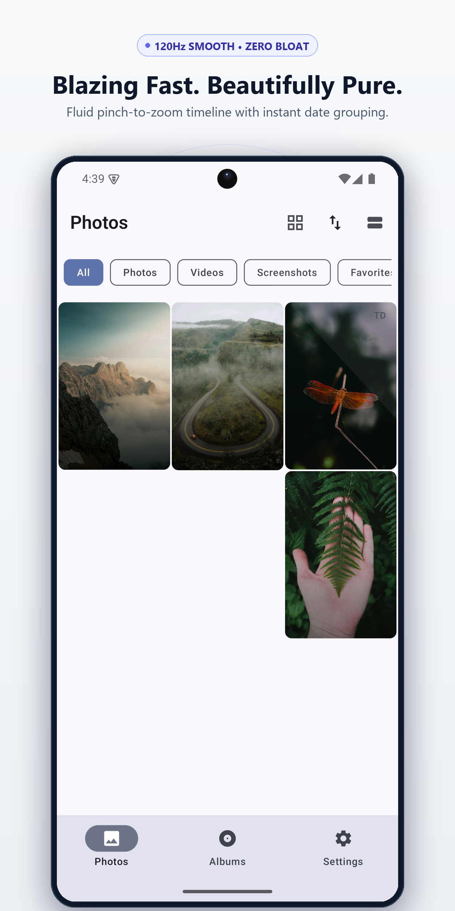
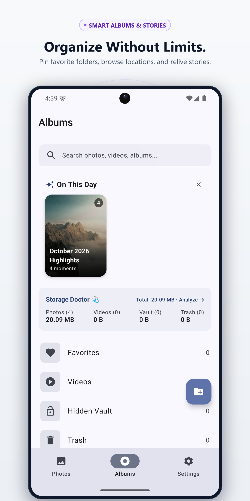
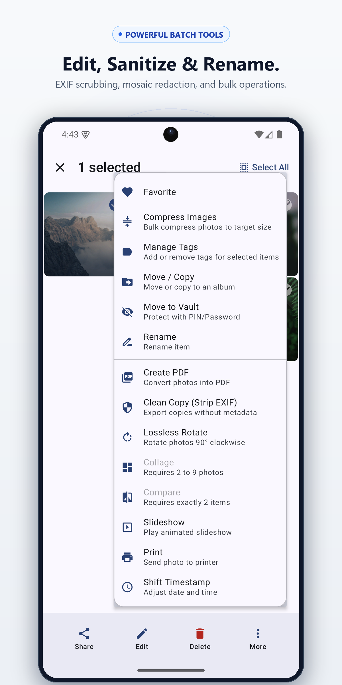
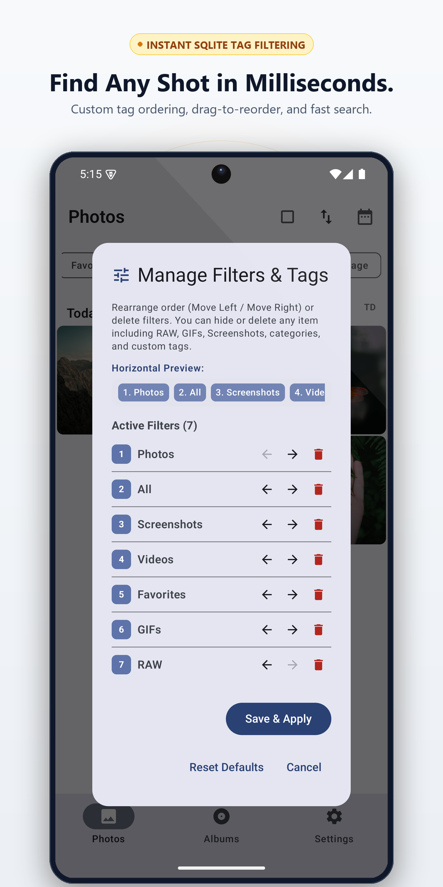
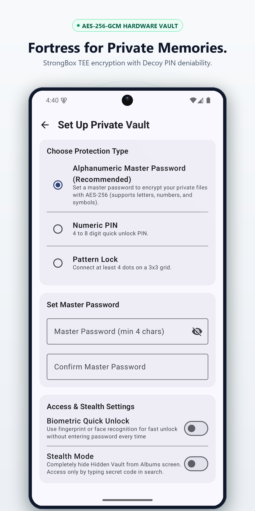
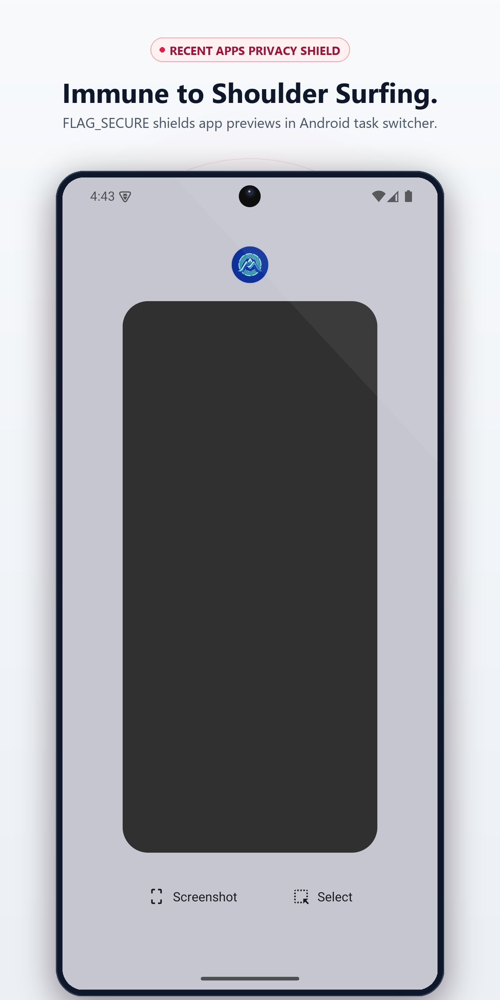
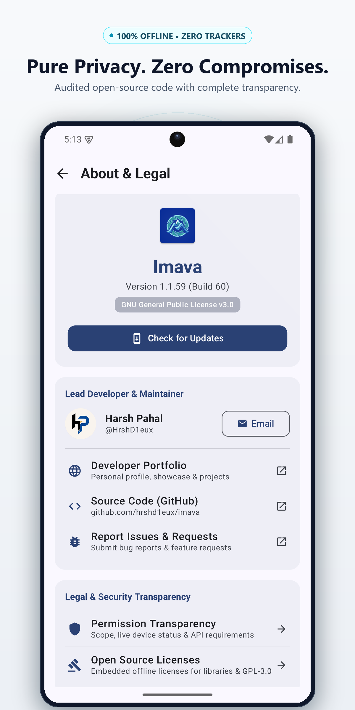
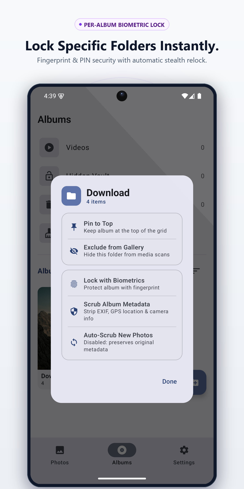

<p align="center">
  
</p>

<h1 align="center">Imava</h1>

<p align="center">
  A privacy-focused Android gallery app built with Jetpack Compose, Hilt, Room, Coil, and Media3.
</p>

---

<!-- SCREENSHOTS_START -->
## Screenshots

<div align="center">
  <table>
    <tr>
      <td align="center" width="25%">
        <b>Photos Timeline</b><br><br>
        
      </td>
      <td align="center" width="25%">
        <b>Albums & Memories</b><br><br>
        
      </td>
      <td align="center" width="25%">
        <b>Batch Selection & Tools</b><br><br>
        
      </td>
      <td align="center" width="25%">
        <b>Filter & Tag Manager</b><br><br>
        
      </td>
    </tr>
    <tr>
      <td align="center" width="25%">
        <b>Hardware Encrypted Vault</b><br><br>
        
      </td>
      <td align="center" width="25%">
        <b>App Switcher Shield</b><br><br>
        
      </td>
      <td align="center" width="25%">
        <b>About & FOSS Transparency</b><br><br>
        
      </td>
      <td align="center" width="25%">
        <b>Album Privacy & Security</b><br><br>
        
      </td>
    </tr>
  </table>
</div>
<!-- SCREENSHOTS_END -->

---

## Features

### Timeline & Performance
- Paging 3 grid with incremental pagination (page size 60)
- Pinch-to-zoom between 1–6 columns with settings slider
- Fast scrubber with equidistant date sampling
- ContentObserver on Images, Video, and Files URIs
- Batched Room queries (500 items/chunk)
- Downsampled 280x280 thumbnails via Coil

### "On This Day" Memories
- Surfaces photos from the same date in previous years
- Fullscreen story viewer with segmented progress bar, auto-advance, tap navigation, hold-to-pause
- 24-hour dismissal persistence, scoped to Albums view

### Photo Collage Maker
- Grid templates for 2–9 photos
- 1:1, 4:5, 9:16, 16:9 aspect ratios
- Adjustable spacing and corner radius
- 2048px JPEG export to `Pictures/Collages`

### Privacy Redaction & Markup
- Destructive pixelation brush for redacting sensitive content
- Freehand pen, arrows, rectangles, ellipses
- Color palette with undo/redo

### Video Frame Capture
- Extract still frames from video playback via `MediaMetadataRetriever`
- Saved to `Pictures/Video_Captures`

### Vault Backup & Restore
- Export vault as encrypted `.imava` container (AES-256-GCM, PBKDF2 250k iterations)
- Restore via SAF for device migration

### Storage Doctor
- Flags large videos (>50 MB), old screenshots (>30 days), burst groups
- "Keep Best" quick cleanup

### Slideshow Player
- Ken Burns pan-and-zoom with crossfade transitions
- 3s / 5s / 8s pacing, shuffle, tap-to-pause

### Photo Comparison
- Side-by-side split viewer (vertical or horizontal)
- Synchronized or independent zoom/pan

### Photo & Video Viewer
- **120Hz Fluid Gesture Swiping**: Butter-smooth horizontal pagination with pre-cached adjacent pages, zero-crossfade instant paints, and smooth 220ms animated double-tap zoom
- **Manual Video Playback**: Videos start paused at frame 0 with centered play button, bottom transport bar, and auto-pause on scroll
- **Conflict-Free Gestures**: Vertical drags control volume/brightness while horizontal swipes slide unimpeded across photos and videos
- Swipe-down-to-dismiss with scaling and alpha fade
- Sub-sampling tile decoder for large images
- Custom tags (`#Receipt`, `#Travel`) stored in Room, searchable
- Print via AndroidX PrintHelper
- Set as wallpaper, set as album cover
- EXIF metadata viewer with "Open in Maps"

### Albums & Privacy Lock
- List, 2/3/4 column grid layouts with custom per-album sort orders
- **Biometric Album Lock**: Lock individual albums with fingerprint/face/PIN
- **Total Timeline Isolation**: Locked album photos are completely excluded from main timeline, videos, and search feeds
- **System-Wide `.nomedia` Protection**: Automatically creates `.nomedia` inside locked album folders to hide contents from all other apps and system MediaStore
- Pin, hide, and exclude folders with storage usage overview

### Motion Photos & Looping GIF Studio
- Embedded micro-video playback with interactive frame scrubber
- **Best-Shot Extraction**: Extract full-sensor, uncompressed stills from motion photos
- **Looping GIF Export**: Convert motion photos to shareable GIFs using a zero-bloat Kotlin GIF89a encoder with Octree quantization
- **Standalone MP4 Export**: Save motion photo video clips to Movies

### Lossless Video Tools
- **1-Second Audio Stripper**: Instantly remove audio tracks losslessly via hardware `MediaMuxer` and `MediaExtractor` without re-encoding (supports 4K/60fps)
- Lossless video trimmer and frame grabber
- 0.25x–3.0x playback speed, swipe gestures, and audio/subtitle track selector

### Interactive Geo Map Explorer
- Zero-overhead in-app Leaflet + OpenStreetMap map viewer (<150 KB, 0 native `.so` binaries)
- Interactive marker clustering for all geotagged photos
- **Dual Querying**: Search by landmark, city, village, or GPS coordinates (`37.77, -122.41`) with smooth flight animations
- Tap any marker to view or open the photo directly

### Custom Location Descriptions & EXIF Editor
- **Free-Form Place Descriptions**: Attach custom place names (e.g. *"delhi rohtak madina village raju printing press meham"*) without requiring numeric coordinates
- **GPS Coordinates Editor**: Add, edit, or scrub latitude/longitude directly in the photo details sheet
- **Gallery Search Indexing**: Find photos instantly by searching any word from custom location descriptions
- Asynchronous reverse geocoding with 1-tap "Open in Maps"

### On-Device OCR & Selective Text Copy
- Privacy-first on-device text recognition via Google Play Services ML Kit (~350 KB footprint)
- **Selective Highlighting**: Drag selection handles or double-tap words to copy exact text snippets
- **Smart Quick-Copy Chips**: 1-tap copy for detected phone numbers, URLs, addresses, and line totals
- **Searchable Gallery**: Search for text visible inside photos directly from the main gallery search bar

### Lossless Move/Copy & Timestamp Preservation
- Moving or copying photos between albums preserves exact original capture timestamps
- Copies original EXIF datetime tags, preserves filesystem `lastModified` down to the millisecond, and synchronizes MediaStore `DATE_TAKEN`
- Migrates favorites, custom tags, and custom locations seamlessly

### Automated Documentation Sync
- Automated synchronization of screenshots from `screenshots/` to `docs/screenshots/`, GitHub Pages website, and `README.md`
- Integrated Git pre-commit hook and Gradle `:syncScreenshots` task

### Batch Rename
- Numbered sequence (`Trip_001.jpg`, `Trip_002.jpg`)
- Date-stamped prefix
- Find & replace

### Photo Editor
- Brightness, contrast, saturation, warmth sliders
- Filter presets (B&W, Warm, Cool, Sepia, Vivid)
- Freeform crop with aspect presets, 90° rotation, flip
- Target-size compressor

### Encrypted Vault
- AES-256-GCM via AndroidKeyStore (12-byte IV, 128-bit tag)
- Transient decryption cache, wiped on lock
- Lossless restore with MediaScanner re-indexing
- PBKDF2 PIN hashing (100k iterations)
- Decoy PIN for plausible deniability
- Rate-limited lockout
- FLAG_SECURE on vault media
- PIN, pattern lock, or biometric auth
- Stealth mode via search trigger

### Duplicate Finder
- Groups by file size, dimensions, duration
- Burst clustering
- Perceptual hashing (dHash + aHash) on 32x32 micro-thumbnails
- Progress reporting

### Advanced Metadata Search & Filter
- Real camera attributes & hardware metadata filtering directly from the Room database (zero network overhead, instant SQLite speed)
- Filter by file size thresholds (`> 100 MB`, `> 500 MB`, `> 1 GB`) for rapid storage management
- Filter by exact resolutions: 4K UHD (`>= 3840x2160`), 1080p Full HD, Panorama (`aspect ratio >= 2:1`), and Portrait
- Filter by camera/phone make and model (e.g., Pixel 8 Pro vs Sony A7IV)
- Date range presets (This Week, This Month, Last 3 Months, Custom Date Range)
- Multi-dimensional compound filtering seamlessly combined with custom tags and favorites

### Direct WebDAV / Local NAS Backup (Zero Cloud)
- **Zero Cloud Reliance**: Optional private backup directly to home NAS appliances (Synology, Nextcloud, TrueNAS, QNAP, ownCloud) or custom WebDAV endpoints over local Wi-Fi.
- **Total Local Privacy**: Zero third-party cloud servers, zero external telemetry, zero subscription lock-in. Your media never leaves your local network.
- **Streaming Native HTTP PUT**: High-performance RFC 4918 WebDAV streaming engine powered by OkHttp, uploading multi-gigabyte 4K video files without memory spikes.
- **Incremental Sync Ledger**: Local Room database sync tracking ensures only newly created or modified media files are transferred, avoiding duplicate uploads.
- **Automated WorkManager Scheduling**: 24-hour periodic background backups with strict **Wi-Fi Only** and **Device Charging** constraints to safeguard cellular data and battery life.
- **Homelab Ready**: Full support for custom ports, basic authentication, configurable destination paths, and optional self-signed SSL/TLS certificates.
- **Live Connection Diagnostics**: One-tap in-app server reachability and credential validator.

### Trash & Cryptographic File Shredder
- **30-day auto-purge**: Configurable trash retention via WorkManager
- **Cryptographic File Shredding (Anti-Recovery)**: Standard OS file deletion (`unlink`) only removes the catalog entry, leaving raw JPEG/MP4 blocks physically intact on flash memory where data recovery tools (DiskDigger, Recuva, PhotoRec) can easily carve them back.
- **Multi-Pass CSPRNG Overwrite**: Streams cryptographically secure pseudo-random bytes in 64KB synchronous buffers (`"rws"`) across all allocated clusters.
- **Magic Header Zeroing**: Overwrites initial 8KB with zeroes (`0x00`) to destroy file format magic bytes (`FF D8 FF`, `\x89PNG`, `ftyp`), defeating raw sector carvers.
- **Hardware Write Cache Flush**: Invokes `FileDescriptor.sync()` and `FileChannel.force(true)` to ensure blocks are physically committed to flash storage.
- **Dentry & Metadata Scrambling**: Truncates file length to 0 bytes and renames the file to a randomized UUID before deletion to prevent directory slack analysis.
- **Toggleable in Settings**: Configurable under *Settings > Privacy & Folders > Cryptographic File Shredder*.

### Advanced Instant Deep Media Scan
- **Instant SQLite Carve (<100ms)**: Direct multi-pattern `MediaStore.Files` database query with `QUERY_ARG_MATCH_NOMEDIA` to discover hidden photos without disk crawl lag.
- **Comprehensive App & Vault Registry**: Automatically discovers media from messaging apps, dual/cloned app spaces, sent folders, documents, and private third-party directories.
- **Hidden & Vault Directories**: Unearths hidden media in `.nomedia`, `.hidden`, `.secret`, `.vault`, `.calculator`, and `.thumbnails` folders with clean, auto-generated album titles.

### Album & Folder EXIF Metadata Stripping
- **In-Place Album Scrubbing**: Strip GPS, device serials, and camera fingerprints across entire albums with one tap.
- **Chronology & Orientation Protection**: Safely preserves `DateTimeOriginal` and `TAG_ORIENTATION` by default so gallery chronological timeline order and portrait photo orientation are never broken.
- **Background Auto-Scrub**: Configure folders (e.g. Camera, Downloads) to automatically sanitize new photos in the background with a 3.5s camera write-lock debounce.

### Privacy & Export
- EXIF metadata stripper for sharing
- Multi-photo PDF export (A4, auto-orientation)

---

## Tech Stack

| Component | Library | Version |
|---|---|---|
| Language | Kotlin | 1.9.22 |
| Annotation Processing | KSP | 1.9.22-1.0.17 |
| UI | Jetpack Compose | 2024.02.00 BOM |
| Architecture | ViewModel + StateFlow | Jetpack |
| DI | Dagger Hilt | 2.51.1 |
| Database | Room | 2.6.1 (KSP) |
| Image Loading | Coil | 2.6.0 |
| Video | Media3 ExoPlayer | 1.3.1 |
| Background Work | WorkManager | 2.9.0 |
| Pagination | Paging 3 | 3.2.1 |
| Biometrics | AndroidX Biometric | 1.1.0 |
| EXIF | AndroidX ExifInterface | 1.3.7 |
| Network & WebDAV | OkHttp & Okio | 4.12.0 |
| Crypto | AndroidKeyStore AES-256-GCM | API 29+ |

---

## Building

```bash
./gradlew testDebugUnitTest
./gradlew assembleRelease
```

CI runs on push to `main` via GitHub Actions (`.github/workflows/`).

---

## License

Copyright (c) 2026 HrshD1eux

Licensed under the **GNU General Public License v3.0 (GPL-3.0-or-later)**. See [LICENSE](LICENSE) for the full license text.

---

## Author & Contact

- **Author**: Harsh Pahal ([@HrshD1eux](https://github.com/HrshD1eux))
- **Portfolio**: [hrshd1eux.vercel.app](https://hrshd1eux.vercel.app/)
- **Email**: `HrshD1eux@proton.me`
- **Issue Tracker**: https://github.com/HrshD1eux/Imava/issues
- **Source Code**: https://github.com/HrshD1eux/Imava
