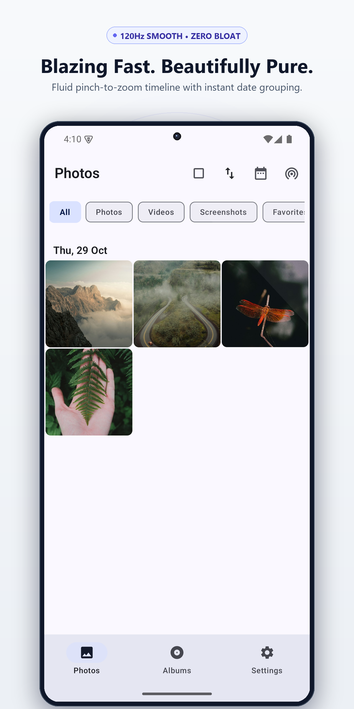
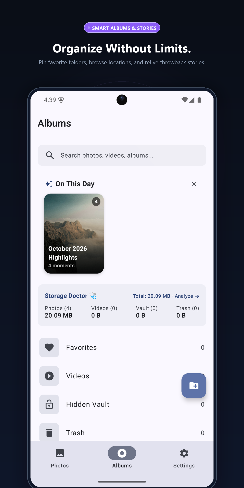
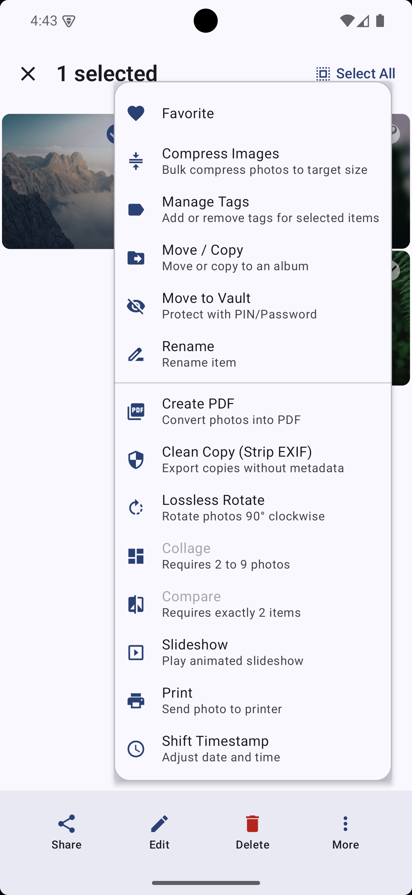
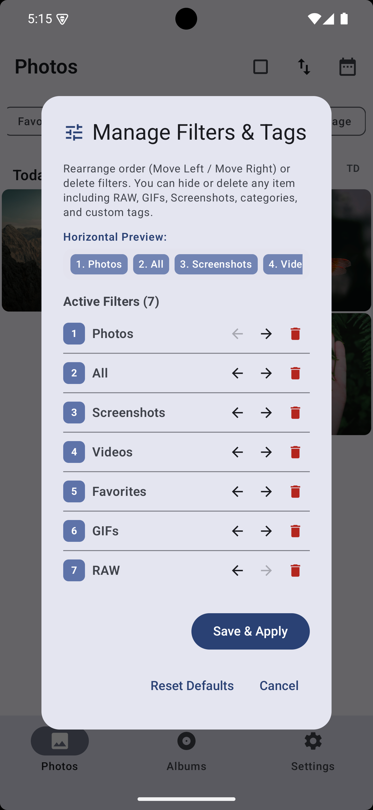
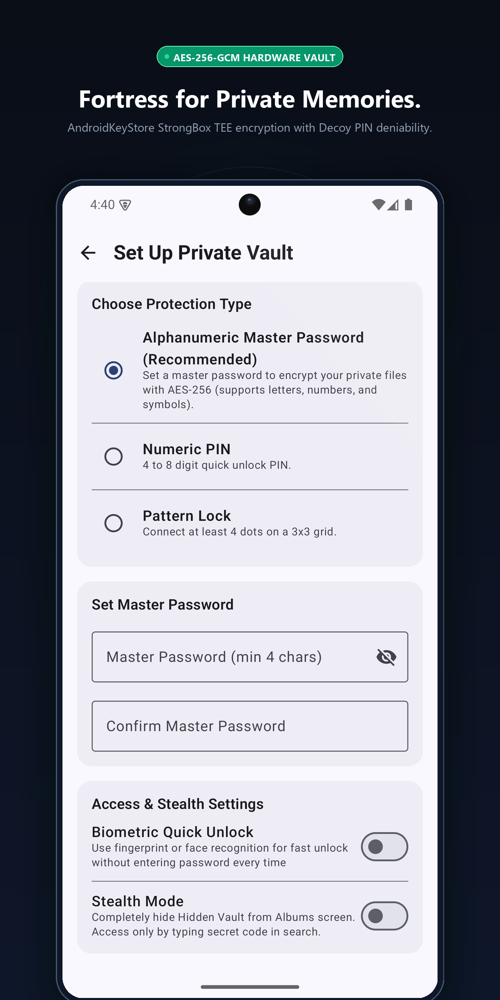
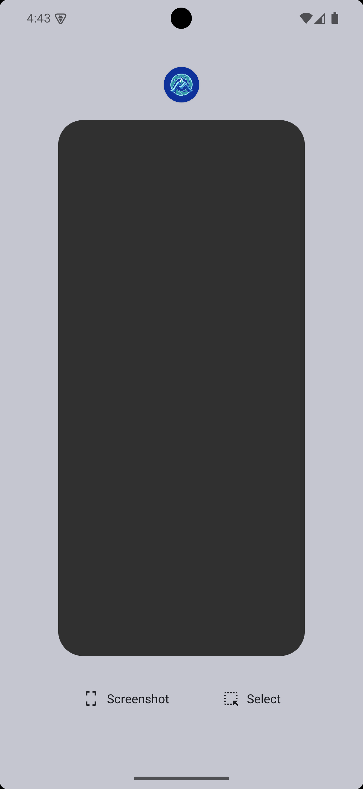
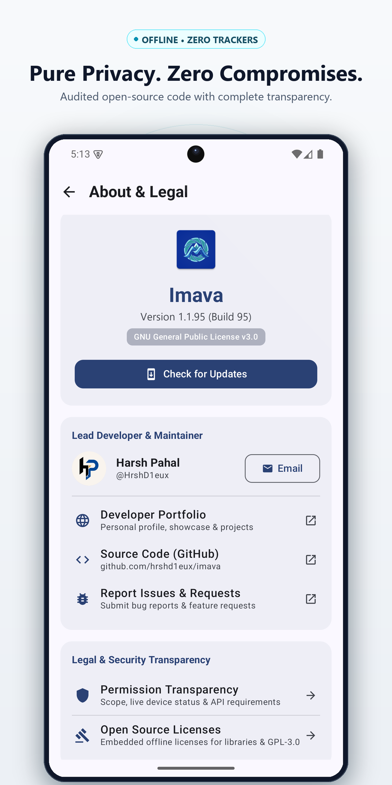
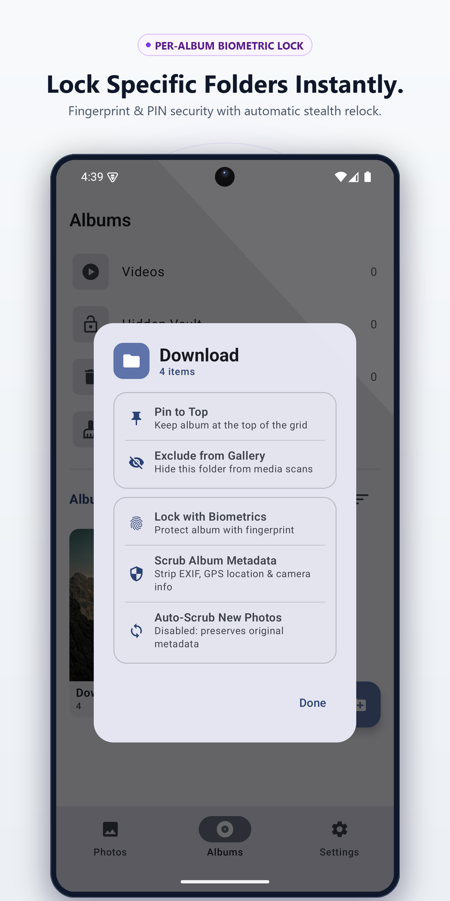

<p align="center">
  
</p>

<h1 align="center">Imava Gallery</h1>

<p align="center">
  <b>The private, offline-first, zero-cloud gallery for Android.</b><br>
  Engineered with Jetpack Compose, Material 3, Room, Coil, and hardware-backed cryptography.
</p>

<p align="center">
  <a href="#license"></a>
  
  
  
</p>

---

<!-- SCREENSHOTS_START -->
## Screenshots

<div align="center">
  <table>
    <tr>
      <td align="center" width="25%">
        <b>Photos Timeline</b><br><br>
        
      </td>
      <td align="center" width="25%">
        <b>Albums & Memories</b><br><br>
        
      </td>
      <td align="center" width="25%">
        <b>Batch Selection & Tools</b><br><br>
        
      </td>
      <td align="center" width="25%">
        <b>Filter & Tag Manager</b><br><br>
        
      </td>
    </tr>
    <tr>
      <td align="center" width="25%">
        <b>Hardware Encrypted Vault</b><br><br>
        
      </td>
      <td align="center" width="25%">
        <b>App Switcher Shield</b><br><br>
        
      </td>
      <td align="center" width="25%">
        <b>About & FOSS Transparency</b><br><br>
        
      </td>
      <td align="center" width="25%">
        <b>Album Privacy & Security</b><br><br>
        
      </td>
    </tr>
  </table>
</div>
<!-- SCREENSHOTS_END -->

---

## Killer & Unique Features

Imava is built specifically for users who refuse cloud telemetry, mandatory accounts, and corporate tracking. Below are the advanced features that set Imava apart from standard Android galleries:

### 1. Direct Wi-Fi P2P Drop ("AirDrop for Android Without Cloud")
- **Instant 50–100+ MB/s Transfers**: Stream full, lossless original photos and 4K videos directly between your Android phone and any PC, Mac, iPhone, Linux, or secondary Android device over local Wi-Fi.
- **Zero Client Software Needed**: Receivers don't install an app or create an account. They simply scan an on-device QR code or open `http://192.168.x.x:8765` in any standard web browser (Chrome, Safari, Firefox, Edge).
- **On-the-Fly Dynamic ZIP Generator**: Download hundreds of selected photos as a single uncompressed ZIP stream with zero intermediate disk space used on your phone.
- **Bidirectional Drag-and-Drop Web Upload**: Desktop computers can drag-and-drop photos and videos directly onto the browser page to transfer them straight into your phone's gallery (`Pictures/ImavaDrop`).

### 2. Cryptographic DoD File Shredder & Biometric Trash Lock
- **Anti-Recovery Physical Sector Overwrite**: Standard OS file deletion (`unlink`) only removes catalog pointers, leaving raw JPEG/MP4 blocks readable by data recovery tools (DiskDigger, Recuva, PhotoRec). Imava's shredder overwrites clusters with cryptographically secure random bytes in 64KB buffers (`"rws"` mode), zeroes magic headers, forces hardware write cache flush via `FileDescriptor.sync()`, scrambles directory entries, and truncates to 0 bytes before unlinking.
- **Biometric Trash Lock**: Specifically guard your Trash folder behind fingerprint, face unlock, or device PIN. Deleted item counts are completely masked until unlocked, preventing nosy friends or family from snooping through deleted photos. Auto-relocks on backgrounding.

### 3. Hardware-Backed AES-256-GCM Vault & Decoy PIN
- **AndroidKeyStore Hardware Isolation**: Media files inside the Hidden Vault are encrypted using AES-256-GCM with hardware-backed keys. Decrypted blocks live only in transient memory and are instantly purged upon locking.
- **Decoy PIN for Plausible Deniability**: Configure a secondary decoy PIN. If coerced to unlock your phone under duress, entering the decoy PIN unlocks an empty, innocent vault interface while keeping your real vault completely hidden.
- **Stealth Mode Access**: Hide the Hidden Vault tile entirely from the Albums screen. It can only be opened by typing your secret access code directly into the gallery search bar.

### 4. Local EXIF Sanitizer & Automatic Background Scrubbing
- **On-the-Fly Metadata Stripping**: Strip embedded GPS coordinates, camera serial numbers, and device fingerprints before sharing photos to messaging apps or social networks.
- **Album-Wide In-Place Scrubbing**: Sanitize entire albums with a single tap while intelligently preserving `DateTimeOriginal` and orientation tags so gallery chronology and photo rotation remain intact.
- **Background Auto-Scrub Daemon**: Automatically sanitize newly captured photos in designated folders (e.g. Camera, Downloads) with a camera write-lock debounce.

### 5. Private WebDAV / Home NAS Zero-Cloud Auto-Sync
- **100% Self-Hosted & Local**: Automatically back up your library to home NAS appliances (Synology, Nextcloud, TrueNAS, QNAP, ownCloud) or custom WebDAV endpoints over your local network.
- **Zero Third-Party Cloud**: No external servers, no subscriptions, and zero telemetry. Media never touches commercial cloud providers.
- **Automated WorkManager Scheduling**: Incremental sync ledger backed by SQLite ensures only new/modified photos are uploaded, with strict **Wi-Fi Only** and **Device Charging** constraints.

### 6. On-Device FOSS OCR & Text Search (Tesseract 5 C++)
- **Google-Free OCR Engine**: Powered by open-source Tesseract 5 C++ via Tesseract4Android (Apache 2.0). Zero dependencies on Google Play Services, Firebase, or proprietary ML blobs.
- **On-Demand Engine Loading**: The fast English recognition model (`eng.traineddata`) is loaded on-demand only when used—keeping the base APK ultra-lean.
- **Searchable Gallery Indexing**: Extracted text from receipts, documents, street signs, and serial numbers is indexed into your local SQLite Room database, making physical text searchable directly from the gallery search bar.
- **Actionable Smart Chips**: 1-tap detection and interaction for phone numbers (call/copy), URLs (browser/copy), and email addresses.

### 7. Instant Deep Media & Hidden Vault Carve (<100ms)
- **Direct SQLite Filesystem Carving**: Direct multi-pattern `MediaStore.Files` database query with `QUERY_ARG_MATCH_NOMEDIA` unearths hidden photos in under 100ms without filesystem crawl lag.
- **App & Cloned Space Registry**: Instantly discovers sent folders, dual/cloned app spaces, and hidden media lurking inside `.nomedia`, `.hidden`, `.secret`, `.vault`, `.calculator`, and `.thumbnails` directories.

### 8. Motion Photo Studio & Octree GIF Studio
- **Micro-Video Frame Scrubber**: Play embedded motion photo video clips with interactive precision frame scrubbers.
- **Best-Shot Extraction**: Extract full-sensor, uncompressed still images from motion photos at full resolution.
- **Pure-Kotlin GIF89a Export**: Export motion photos to looping GIFs using a built-in, zero-dependency Octree color quantizer.

### 9. Interactive Geo Map & Spatial Descriptions
- **Zero-Binary Map Explorer**: Lightweight Leaflet + OpenStreetMap engine (<150 KB, 0 native `.so` binaries) with dynamic cluster markers for all geotagged photos.
- **Free-Form Spatial Search**: Add descriptive place tags (e.g., *"delhi rohtak madina village printing press"*) without needing numeric coordinates, with instant gallery search indexing.

### 10. Native 11+ Multi-Language Engine & Android 13+ Per-App Locale
- **Complete Native Translations**: 100% offline translations across 11 languages: **Spanish, Portuguese (Brazil), German, Russian, French, Hindi, Bengali, Marathi, Telugu, Tamil, and Gujarati**.
- **Android 13+ Per-App Locale Architecture**: Fully integrated with Android's system-level `LocaleManager` (`android:localeConfig`) as well as an in-app selector with native script typography.

### 11. Privacy Shield & Biometric App Lock
- **Recent Apps Masking**: Applies `FLAG_SECURE` to prevent Android's recent task switcher from snapshotting personal photos or vault contents.
- **Biometric App Guard**: Secure entire gallery launch behind fingerprint, face unlock, or PIN with rate-limited lockout protection.

---

## Tech Stack

Imava is crafted with a pure, audited open-source foundation:

| Layer | Technology | License |
|:---|:---|:---:|
| **Language** | Kotlin 1.9.22 | Apache 2.0 |
| **UI Toolkit** | Jetpack Compose (Material 3) | Apache 2.0 |
| **Architecture** | ViewModel + StateFlow + Kotlin Coroutines | Apache 2.0 |
| **Dependency Injection** | Dagger Hilt 2.51.1 | Apache 2.0 |
| **Database** | SQLite via Room 2.6.1 (KSP) | Apache 2.0 |
| **Image Loading** | Coil 2.6.0 (Custom MediaStore Fetcher & Sub-sampling) | Apache 2.0 |
| **Media Player** | AndroidX Media3 ExoPlayer 1.3.1 | Apache 2.0 |
| **Background Work** | AndroidX WorkManager 2.9.0 | Apache 2.0 |
| **Authentication** | AndroidX Biometric 1.1.0 | Apache 2.0 |
| **Cryptography** | AndroidKeyStore AES-256-GCM + PBKDF2 | Hardware-Backed |
| **Networking & NAS** | OkHttp 4.12.0 + Okio | Apache 2.0 |
| **On-Device OCR** | Tesseract 5 & Leptonica (Tesseract4Android) | Apache 2.0 |
| **Map Rendering** | Leaflet + OpenStreetMap (<150 KB, 0 native binaries) | BSD-2-Clause |

---

## Contribution Guidelines

Contributions from the open-source community are welcome! To maintain Imava's standards, all contributions must adhere to the following rules:

### Core Principles
1. **100% Offline & Zero Telemetry**: Never introduce analytics SDKs, ads, proprietary tracking blobs, or network calls to commercial servers.
2. **Zero-Bloat Architecture**: Avoid adding heavy libraries. If an algorithm (like GIF encoding, hashing, or math) can be implemented cleanly in Kotlin, do not pull in massive third-party dependencies.
3. **Privacy First**: Sensitive data, vault contents, and deleted trash items must remain strictly protected and encrypted.

### Development Workflow
1. **Fork & Branch**:
   ```bash
   git checkout -b feat/your-feature-name
   ```
2. **Mandatory Updates on Changes**:
   - **New Permissions**: Update `AndroidManifest.xml` comments and the in-app `PermissionsTransparencyScreen.kt`.
   - **New Dependencies**: Document in `AboutLegalScreen.kt`, `OpenSourceLicensesScreen.kt`, and this `README.md`.
   - **New Features**: Add UI exposure with tactile haptic feedback, and ensure all user-facing strings are localized across all 11+ language resource files (`app/src/main/res/values-*/strings.xml`).
3. **Verify Tests & Build**:
   ```bash
   ./gradlew compileDebugKotlin
   ./gradlew testDebugUnitTest
   ./gradlew assembleDebug
   ```
   All tests must pass with zero compilation errors and zero broken benchmarks.
4. **Submit a Pull Request**: Provide a clear description of the feature or fix, referencing any relevant issues.

---

## Building from Source

```bash
# Clone the repository
git clone https://github.com/HrshD1eux/Imava.git
cd Imava

# Run debug unit test suite
./gradlew testDebugUnitTest

# Build debug APK
./gradlew assembleDebug

# Build optimized release APK (requires keystore.properties)
./gradlew assembleRelease
```

---

## License

Copyright (c) 2026 Harsh Pahal (HrshD1eux).

Licensed under the **GNU General Public License v3.0 (GPL-3.0-or-later)**. See [LICENSE](LICENSE) for the full text.

---

## Author & Community

- **Lead Developer**: Harsh Pahal ([@HrshD1eux](https://github.com/HrshD1eux))
- **Email**: `HrshD1eux@proton.me`
- **Issue Tracker**: [GitHub Issues](https://github.com/HrshD1eux/Imava/issues)
- **Source Code**: [github.com/HrshD1eux/Imava](https://github.com/HrshD1eux/Imava)
